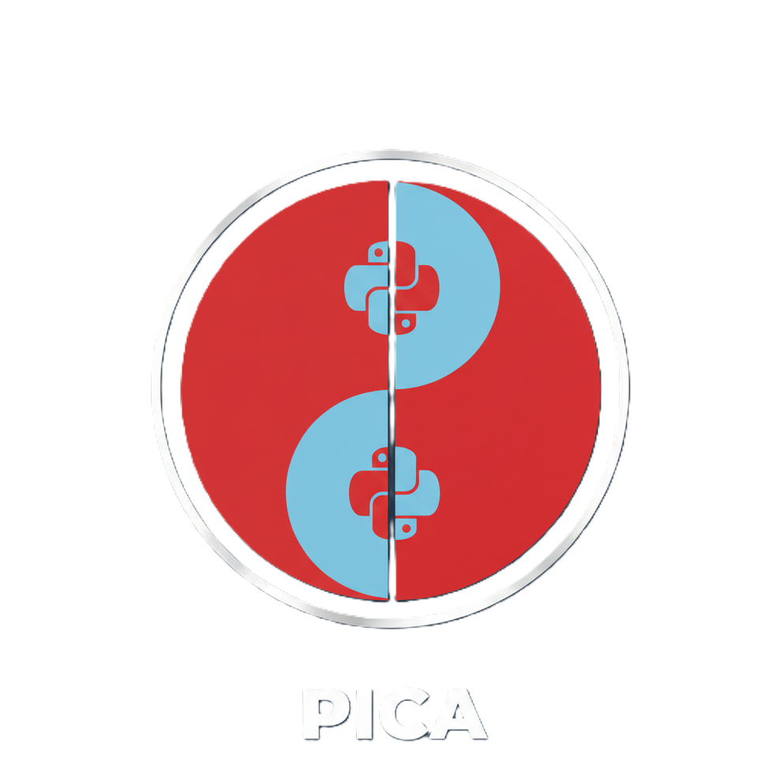
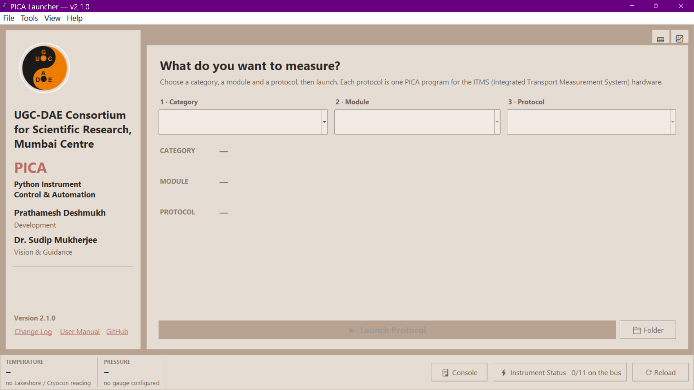
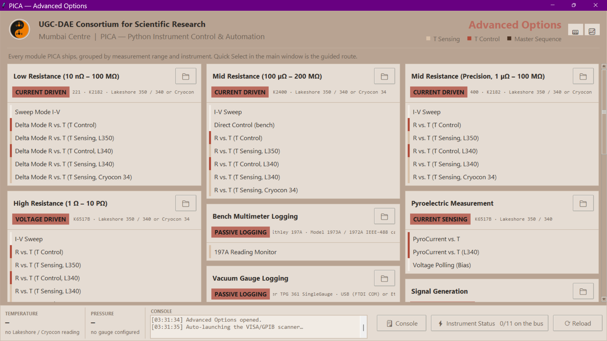
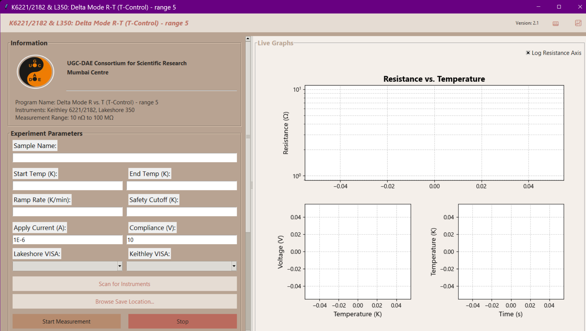
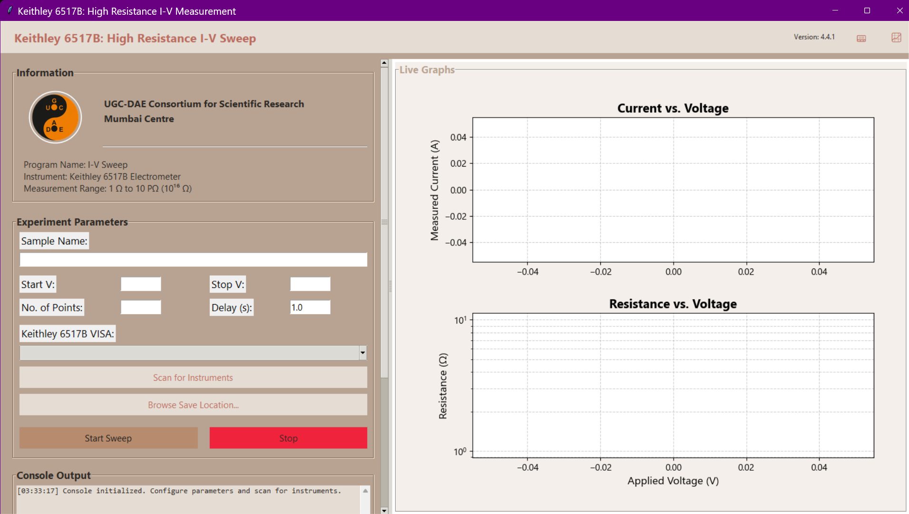

# PICA: Advanced High-Precision Transport Measurement Automation with Python

**Open-source Python suite for laboratory instrument control and automation** — GPIB/VISA & SCPI orchestration of Keithley, Keysight, Lakeshore, and Novocontrol instruments for cryogenic transport, resistivity, I-V, dielectric, and pyroelectric measurements.

**Documentation: [prathameshnium.github.io/PICA-Python-Instrument-Control-and-Automation](https://prathameshnium.github.io/PICA-Python-Instrument-Control-and-Automation/)** · [User Manual](docs/User_Manual.md) · [PyPI](https://pypi.org/project/pica-suite/) · Install: `pip install pica-suite`

<p align="center">
  
</p>

<p align="center">
  <a href="https://github.com/prathameshnium/PICA-Python-Instrument-Control-and-Automation/actions/workflows/test.yml"></a>
  <a href="https://github.com/prathameshnium/PICA-Python-Instrument-Control-and-Automation/actions/workflows/lint.yml"></a>
  <a href="https://github.com/prathameshnium/PICA-Python-Instrument-Control-and-Automation/actions/workflows/codeql.yml"></a>
  <a href="https://github.com/prathameshnium/PICA-Python-Instrument-Control-and-Automation/actions/workflows/draft-pdf.yml"></a>
  <a href="https://pica-python-instrument-control-and-automation.readthedocs.io/en/latest/"></a>
  <a href="https://codecov.io/gh/prathameshnium/PICA-Python-Instrument-Control-and-Automation"></a>
  <a href="https://pypi.org/project/pica-suite/"></a>
  <a href="https://github.com/prathameshnium/PICA-Python-Instrument-Control-and-Automation/actions/workflows/test.yml"></a>
  <a href="https://doi.org/10.5281/zenodo.18377216"></a>
  <a href="https://pypi.org/project/pica-suite/"></a>
  <a href="https://pypi.org/project/pica-suite/"></a>
  <a href="LICENSE"></a>
  <br />
  <a href="https://prathameshnium.github.io/PICA-Python-Instrument-Control-and-Automation/"></a>
  <a href="docs/User_Manual.md"></a>
  <a href="CONTRIBUTING.md"></a>
  <a href="CODE_OF_CONDUCT.md"></a>
  <br />
  
  
  
  
  <a href="https://github.com/prathameshnium/PICA-Python-Instrument-Control-and-Automation/stargazers"></a>
  
  
  
</p>

---

> **v1.0.7:** Linux install guide, Keithley 2400 memristor modules, C-V module v2, launcher module search and hover cards. Install or upgrade via pip: `pip install --upgrade pica-suite`

---

## Overview

High-precision, low-noise transport measurements are essential for advancing research in spintronics and materials characterisation. **PICA (Python-based Instrument Control and Automation)** is a modular, open-source software suite designed to automate advanced transport measurements for electronic devices and material samples. It runs on a standard Windows laboratory PC, and its installation, tests and windows are also verified on Linux.

PICA provides an extensible, unified graphical user interface (GUI) for orchestrating high-precision instruments — current source (DC/AC) units, nanovoltmeters, high resistance electrometers, impedance analysers, and temperature controllers such as the **Keithley 6221, 2182, 2400, and 6517B**, the **Keysight E4980A LCR meter**, the **Lakeshore 350/340**, the **Cryo-con 34**, and (experimentally) the **Novocontrol Alpha-AN**. Built on the robust Python scientific ecosystem (PyVISA, NumPy, pandas, Matplotlib), PICA drives these instruments together from one interface.

The suite performs automated protocols including:
* Temperature-dependent wide-range resistance measurement ($10^{-8}$ - $10^{16}$ Ω).
* Current-voltage (I-V) characterisation.
* Capacitance characterisation and magnetocapacitance studies (20 Hz - 2 MHz).
* Pyroelectric current measurement (resolution $10^{-15}$ A).

<p align="center">
  
  <br>
  <em>PICA Launcher v2. Quick Select picks a category, a module and a protocol, then launches that program; the status strip shows the temperature, the pressure (when a gauge is configured) and the result of the bus scan, read at startup and on Reload. This is Launcher v2 (<code>python -m pica.main_v2</code>); the 2.1.0 in its title is the launcher's own version, not the package version.</em>
</p>
<p align="center">
  
  <br>
  <em>Advanced Options (Ctrl+Shift+A): every module PICA ships, grouped by measurement range and instrument, for when you already know which program you want. Hovering a row opens a card describing the measurement, its instruments and its inputs; Ctrl+F opens a search that finds any module by a few letters.</em>
</p>

> **More details here:**
> Full online documentation is available at [https://prathameshnium.github.io/PICA-Python-Instrument-Control-and-Automation/](https://prathameshnium.github.io/PICA-Python-Instrument-Control-and-Automation/).
> For usage guides, see the [User Manual](docs/User_Manual.md).

## Table of Contents

- [Overview](#overview)
- [What's New in v1.0.7](#whats-new-in-v107)
- [Motivation](#motivation)
- [Key Features](#key-features)
- [Design and Implementation](#design-and-implementation)
- [Supported Hardware Modules](#supported-hardware-modules)
- [Utilities & Tools](#utilities--tools)
- [Demonstration of PICA (Screencast)](#demonstration-of-pica-screencast)
- [Getting Started](#getting-started)
  - [Installing on Linux](#option-3-installing-on-linux)
- [Running the Software](#running-the-software) (incl. Launcher v2 Quick Select and Advanced Options)
- [System Requirements & Compatibility](#system-requirements--compatibility)
- [Running Tests Locally](#running-tests-locally)
- [Project History](#project-history)
- [Resources & Documentation](#resources--documentation)
- [Citation](#citation)
- [Authors & Funding](#authors--funding)
- [License](#license)

---

## What's New in v1.0.7

**v1.0.7** (October 2026) is the latest release, available on PyPI and GitHub Releases.

```bash
pip install pica-suite==1.0.7
# or upgrade from a previous version:
pip install --upgrade pica-suite
```

Highlights — *changes since v1.0.6*:

* **Linux documentation:** a Linux install guide (venv, tkinter, `pyvisa-py`, USB-TMC / serial / GPIB) and a "Linux report" issue template; running against real instruments on Linux is not yet verified.
* **Memristor modules (Keithley 2400):** switching I-V sweep, retention and endurance programs, plus a read-only Memristor Analysis utility.
* **C-V module v2 (Keysight E4980A):** rewritten sweep builder (bipolar, unipolar, ladder), bus-error retry and a separate event log.
* **K6221 / 2182 I-V:** custom list sweeps (paste from the List Maker), µA units and zero-crossing fixes.
* **Launcher v2 updates:** module search (`Ctrl+F`), hover cards in Advanced Options, View menu and an in-app viewer for the manual, README, change log and license.
* **Packaging, CI & utilities:** cleaner wheel, wider CI matrix (Python 3.10-3.13, Linux GUI smoke test), Quick Calc typesetting, Time Utility event log.

For the full changelog, see [`CHANGELOG.md`](CHANGELOG.md).

---

## Motivation

Advancements in experimental physics and device manufacturing depend on the precise characterisation of material properties under extreme physical conditions. Researchers often face a binary choice: purchase expensive proprietary software or develop custom measurement scripts from scratch.

Libraries such as [**PyVISA**](https://github.com/pyvisa/pyvisa) and [**PyMeasure**](https://github.com/pymeasure/pymeasure) provide foundational drivers but leave users to write and maintain the measurement code. **PICA builds on these libraries** to offer a ready-to-run application. It provides a ready-to-run graphical interface that abstracts the underlying control logic, allowing experimentalists to focus on data acquisition without extensive software development overhead.

PICA enables continuous operation across a full range of measurements, from ultra-low resistance (with thermal offsets cancelled) to high-impedance, electrometric, pyroelectric and capacitance measurements, within a single framework.

## Key Features

* **Accessibility:** A GUI launcher lets researchers without coding experience configure and run measurement protocols from pre-packaged modules.
* **Operational Validation:** Validated via cryogenic transport measurements using a custom-designed probe in conjunction with a **Physical Property Measurement System (PPMS)** (5-380 K, up to 14 Tesla) at the [UGC DAE Consortium for Scientific Research, Mumbai Centre](https://www.csr.res.in/Mumbai_Centre).
* **Fault Tolerance:** The launcher starts each measurement program in its own process, so a hardware timeout or driver crash in one program does not freeze the launcher or the other programs.
* **CLI Templates:** About fifteen measurements also have an `Instrument_Control` script (run from `pica-cli`) that can be adapted for headless automation or other workflows.
* **Operational Transparency:** PICA exposes real-time, time-stamped logs of what each module is doing (e.g., `[10:05:25] Starting stabilization process...`). This aids debugging, ensures scientific reproducibility, and allows verification of measurement protocols.
* **Open Source Extensibility:** Researchers can integrate new instrument drivers or experimental protocols by copying the closest existing module and changing its SCPI commands. Every module is a single self-contained file, so a new one does not touch the others.

---

## Design and Implementation

PICA is built on a modular architecture characterised by self-contained modules, so adding a module cannot break the others. Each measurement is one file with no shared measurement code; the reasoning is in [CONTRIBUTING.md](CONTRIBUTING.md#why-measurement-modules-are-self-contained).

### Process Isolation and Concurrency
The launcher starts every measurement program in its own process with Python's standard `multiprocessing` library.
* **Stability:** If an instrument hangs, only that program's process is affected. It can be closed without freezing the launcher or the other open programs, and data already written stays on disk.
* **Responsiveness:** The `tkinter`-based frontend remains responsive for live `matplotlib` data plotting even while the backend waits for hardware triggers.
* **Data Integrity:** Each data point is appended to the file as soon as it is measured, so a crash or power cut loses at most the point in progress.

### Hardware Abstraction Layer
PICA utilizes [**PyVISA**](https://github.com/pyvisa/pyvisa) to abstract low-level communication protocols (GPIB, USB, Ethernet). The software implements a strict initialization routine:
1.  **Connection Verification:** A built-in "VISA Instrument Scanner" queries the bus (`*IDN?`) to map instrument addresses.
2.  **Instrument Reset:** Modules that control an instrument reset it (`*RST` / `*CLS`) to a known state; read-only sensing modules never write to the thermometer.
3.  **Shutdown:** On finish, Stop, error or window close, sources are switched off and heaters set to off.

### Testing and Simulation
PICA includes a testing suite using `pytest` and `unittest.mock` to simulate VISA resources, allowing verification of backend logic streams and command sequences without constant access to physical instruments.

---

## Supported Hardware Modules

These modules drive the following hardware. The ranges are those of the instruments, together spanning 24 orders of magnitude in resistance.

| Module | Configuration / Instrument | Use Case | Range |
| :--- | :--- | :--- | :--- |
| **Ultra Low Resistance Measurements** | **Keithley 6221** + **K2182** + Lakeshore 350/340 | Superconductors & metallic films; cancels thermal EMFs by current reversal (Keithley Delta mode). | 10 nΩ - 100 MΩ |
| **Mid-Resistance (Standard)** | **Keithley 2400** SourceMeter + Lakeshore 350/340 | Semiconductors, oxides, general transport. | 100 µΩ - 200 MΩ |
| **Mid-Resistance (High-Precision)** | **Keithley 2400** + **K2182** + Lakeshore 350/340 | Detecting subtle phase transitions. | 1 µΩ - 100 MΩ |
| **High-Resistance** | **Keithley 6517B** Electrometer + Lakeshore 350/340 | High bandgap materials, polymers, & ceramics. | 1 Ω - 10 PΩ |
| **Capacitance Analysis** | **Keysight E4980A** + Lakeshore 350/340 | C-V Analysis and Magnetocapacitance characterisation. | 20 Hz - 2 MHz |
| **Pyroelectric** | **K6517B** + Lakeshore 350/340 | Current vs Temp (detecting Curie temperature). | $10^{-15}$ A Resolution |
| **Broadband Dielectric Spectroscopy** *(experimental)* | **Novocontrol Alpha-AN** + ZG4 interface | Frequency scans, C-V, temperature-step and temperature scans of dielectric & impedance spectra, with WinDETA-compatible exports. | 20 Hz - 10 MHz |
| **AC Transport** *(experimental)* | **Keithley 6221** + SR830 lock-in or Keithley 197A | Four-probe AC I-V, frequency scan and R-T. | |
| **Memristor Switching** *(v1.0.7)* | **Keithley 2400** | Switching I-V, retention and endurance of resistive-switching devices. | ±200 V source, compliance set per run |

*Each module drives specific instruments; adapting one to a similar model usually means editing its SCPI commands.*

> [!NOTE]
> **Understanding "Delta Mode":** The term "Delta Mode" refers specifically to a technique used by Keithley Models 6220 and 6221 Current Sources in conjunction with the Model 2182/2182A Nanovoltmeter for very low resistance measurements. This method is described in detail in the [Keithley Low Level Measurements Handbook](https://www.tek.com/en/documents/product-article/keithley-low-level-measurements-handbook---7th-edition). In this documentation, "Ultra Low Resistance Measurements" is used as the general scientific term, while "Delta Mode" may appear when specifically referencing the Keithley-specific method or program files.

### Advanced Temperature Step Control (Lakeshore 350)

`pica/lakeshore/T_Control_L350_Step_GUI_advanced.py` is a self-contained, advanced version of the classic step-sequence controller (`T_Control_L350_Step_GUI.py`, which remains unchanged for existing workflows). It embeds the field-tested v1.2 stabilization logic (two-stage approach, rolling-window tolerance + drift criterion, stabilization timeout) and adds:

- **Adaptive ramp rate** — the rate is computed per step as `|ΔT| × Step Factor`, then hard-capped by an editable low-temperature table (`77:0.3, 100:0.5, else:5` = max 0.3 K/min below 77 K, 0.5 K/min below 100 K, otherwise 5 K/min). This suppresses the large overshoot seen below 100 K on LN2-dewar probes, where even a small heater input raises the temperature substantially. The first setpoint of a run is approached extra slowly (**First-Step ×**, default 0.5). Untick *Adaptive ramp rate* to use a fixed manual rate.
- **Approach from one side** — optional "always from below/above" mode for hysteresis-sensitive measurements: the slow final ramp always enters the setpoint from the chosen side.
- **Stability criteria** — configurable ±tolerance band, rolling window length, drift limit (K/min), and a max-wait timeout with a loud warning if stabilization fails.
- **Safety** — hardcoded 340 K kill switch, user-set soft Max-Temp limit with graceful abort (ramp stopped, heater off), heater-range checks, and crash-safe shutdown on window close or error.
- **Run control & logging** — Pause/Resume, Skip Step, live-editable sequence, per-poll CSV (with ramp rate + phase columns), a per-setpoint summary CSV (rate used, stabilization time, outcome), and a live plot showing the setpoint and its tolerance band. After each stabilization the program beeps and waits for the **Proceed** button (external-measurement handshake).

The combined dielectric-scan program `pica/keysight/Step_Frequency_Scan_E4980A_GUI.py` carries the same advanced control set — adaptive ramp rate, approach-from-one-side, Pause/Skip, soft Max-Temp limit, tolerance band, and stabilization-summary CSV — as an embedded copy (every PICA program stays self-contained). Being an unattended overnight program, on stabilization timeout it logs a loud warning and proceeds with the frequency sweep instead of waiting.

### Module Previews

<p align="center">
  
  <br>
  <em>R-T measurement interface using the K6221/2182 for low-resistance samples, employing the Ultra Low Resistance Measurement technique to cancel thermal EMFs.</em>
</p>
<p align="center">
  
  <br>
  <em>Interface for current-voltage (I-V) characterisation of high-impedance materials using the Keithley 6517B Electrometer.</em>
</p>

---

## Utilities & Tools

Beyond the measurement modules, PICA ships a growing set of standalone laboratory utilities, all accessible from the launcher:

* **VISA Instrument Scanner** — queries the GPIB/USB/Ethernet bus (`*IDN?`) to map connected instrument addresses.
* **PICA Plotter Utility** — multi-file data plotting for comparison and analysis during or after measurements.
* **SCPI Console** *(v1.0.6)* — interactive terminal for sending raw SCPI commands to any VISA instrument.
* **Diagnostic Tools** — read-only checks of the Python environment, system drivers, communication interfaces, the Cryo-con 34 and the Novocontrol Alpha-AN, from the Launcher v2 Tools menu.
* **PPMS helper utilities** *(v1.0.6)* — plotter, sequence visualizer, and time estimator for Quantum Design PPMS workflows.
* **Calculators & helpers** — List Maker, Quick Calc, unit converter, MD-ratio calculator, PID simulator, Time Utility and the read-only Memristor Analysis *(v1.0.7)*.

---

## Demonstration of PICA (Screencast)

**A screencast demonstrating the high resistance IV module is available at [this link](https://drive.google.com/file/d/13W-Z4N-08t9m0xxuR30sjTLmUVG1VyQd/view?usp=sharing).**

---

## Pre-requisites: The VISA Driver

> [!WARNING]
> **A VISA Backend is Required:** [`PyVISA`](https://github.com/pyvisa/pyvisa) is a Python wrapper, not a driver. For PICA to communicate with hardware, you **must** install a VISA backend on your system first. If you attempt to run the software on a clean machine without a VISA implementation, it will fail to find the instruments. This is the most common failure point for new instrument control setups.
>
> Choose one of the following:
> - **NI-VISA:** The industry standard from National Instruments. Download and install it from the [NI website](https://www.ni.com/en/support/downloads/drivers/download.ni-visa.html#575764).
> - **PyVISA-py:** A backend written in pure Python that is installed automatically with PICA. It can be used as a fallback but may have limitations compared to vendor-specific drivers like NI-VISA. [PyVISA-py GitHub](https://github.com/pyvisa/pyvisa-py)
>
> **Before proceeding, verify your VISA installation.**

---

## Getting Started

PICA is available on [PyPI](https://pypi.org/project/pica-suite/) and structured as a standard Python package. Options 1 and 2 are for Windows, the platform PICA is validated on in the lab. For Linux, see [Option 3](#option-3-installing-on-linux).

**No instruments?** The [Try PICA Without Instruments](docs/User_Manual.md#35-try-pica-without-instruments) walk-through in the User Manual shows the launcher, a measurement module, the Plotter (on example data), the PID simulator and the mocked-instrument test suite, with no hardware needed.

### Option 1: Install from PyPI (Recommended)

```bash
pip install pica-suite
```

To upgrade to the latest version (currently **v1.0.7**):

```bash
pip install --upgrade pica-suite
```

> **Tip: faster install.** [uv](https://docs.astral.sh/uv/) (a ~15 MB download, installed once per PC) installs the same packages several times faster than pip and reuses its cache for every new venv:
> ```bash
> pip install uv
> uv pip install pica-suite
> ```
> Plain `pip` works the same; uv is optional.

### Option 2: Install from Source

1.  **Clone the Repository**
    ```bash
    git clone https://github.com/prathameshnium/PICA-Python-Instrument-Control-and-Automation.git
    cd PICA-Python-Instrument-Control-and-Automation
    ```

2.  **Create Virtual Environment & Install**
    ```bash
    # Create and activate a virtual environment
    python -m venv venv
    venv\Scripts\activate

    # Install the package and its dependencies
    pip install .
    ```

    To update PICA to the latest version, run the following command in the project directory:
    ```bash
    pip install --upgrade .
    ```
    If you are already in your virtual environment and want to force Python to reinstall the package (overwriting the old one), run this in your root project folder:
    ```bash
    pip install --force-reinstall .
    ```

3.  **Development install (for contributors)**

    To work on PICA itself, install it in editable mode together with the test and lint tools. Edits to the source then take effect without reinstalling:
    ```bash
    pip install -e .
    pip install -r requirements-dev.txt
    ```
    Then run the test suite to confirm the setup (see [Running Tests Locally](#running-tests-locally)):
    ```bash
    pytest
    ```

    *Note: Ensure you have the NI-VISA drivers installed on your host machine to allow [`PyVISA`](https://github.com/pyvisa/pyvisa) to communicate with the hardware.*

### Option 3: Installing on Linux

> [!WARNING]
> **Talking to real instruments from Linux has not been verified yet.** Installation, the full test suite and the GUI windows have been checked on Linux, but no measurement has yet been run against real hardware from a Linux machine. Lab use so far has been on Windows. If something does not work, please [open a Linux issue](https://github.com/prathameshnium/PICA-Python-Instrument-Control-and-Automation/issues/new?template=linux_report.md) with your distribution, your VISA backend and the instrument model.

**What has been checked:**

| Check | Ubuntu 24.04, CI on every push (full suite on Python 3.10, GUI smoke test on 3.13) | Ubuntu 26.04, Python 3.14 (manual) |
|---|---|---|
| `pip install` | Yes | Yes |
| Test suite (mocked instruments) | Yes | Yes |
| Programs in the launcher, plus both launchers, open | Yes, real Tk windows under xvfb (`tests/test_gui_windows_open_for_real.py`); all except the 32-bit Alpha-AN scan, see below | Yes, same exception |
| Measurement against real instruments | No, not yet verified | No, not yet verified |

**1. Install the system packages.** Tkinter and the emoji font are usually not part of a minimal install. Without the font, the icons on buttons show as empty boxes.

```bash
# Debian / Ubuntu
sudo apt install python3-venv python3-tk fonts-noto-color-emoji

# Fedora
sudo dnf install python3-tkinter google-noto-color-emoji-fonts

# Arch
sudo pacman -S tk noto-fonts-emoji
```

**2. Create a virtual environment and install PICA.**

```bash
python3 -m venv ~/pica-venv
source ~/pica-venv/bin/activate
pip install pica-suite
```

**3. Set up a VISA backend.** On Linux, PICA uses the pure-Python [`pyvisa-py`](https://github.com/pyvisa/pyvisa-py) backend, which `pip install pica-suite` installs for you. Each kind of connection needs one extra piece:

| Connection | What you need |
|---|---|
| Ethernet (LAN / VXI-11 / raw socket) | Nothing extra |
| Serial (RS-232 / USB-serial adapter) | Nothing extra (`pyserial` is installed with PICA, via PyMeasure) |
| USB (USB-TMC instruments) | `pip install pyusb`, plus a udev rule giving your user access to the device ([pyvisa-py docs](https://pyvisa.readthedocs.io/projects/pyvisa-py/en/latest/)) |
| GPIB card | The [linux-gpib](https://linux-gpib.sourceforge.io/) kernel driver for your card, then `pip install "pica-suite[gpib]"` |

NI-VISA also exists for Linux, but only for a few distributions. See [NI's Linux support page](https://www.ni.com/en/support/documentation/compatibility/21/ni-hardware-and-operating-system-compatibility.html).

To use serial ports, your user must be in the `dialout` group. Log out and back in after running this:

```bash
sudo usermod -aG dialout $USER
```

Check that the backend sees your instruments:

```bash
pyvisa-info
python -c "import pyvisa; print(pyvisa.ResourceManager('@py').list_resources())"
```

**4. Run PICA.** Start it the same way as on Windows (see [Running the Software](#running-the-software)):

```bash
pica-gui
```

**Differences from Windows:**
- **Sleep during overnight runs.** On Windows, the long unattended programs (the E4980A temperature, frequency and PPMS scans, the Alpha-AN temperature-step and temperature-sensing scans, the Cryo-con 34 R-T modules and the pressure logger) stop the PC from sleeping during a run; other modules do not. On Linux none can, so block sleep yourself, for example by launching PICA through `systemd-inhibit`:
  ```bash
  systemd-inhibit --what=idle:sleep --why="PICA measurement" pica-gui
  ```
- **Alert sounds.** Most modules fall back to the system bell on Linux for the end-of-run and alarm beeps, and it may be muted. The three Keithley 2400 memristor modules beep only on Windows and are silent on Linux. The on-screen banners and logs still appear.
- **Different fonts.** Linux draws the windows with its default fonts, usually DejaVu. The layout is the same, but the text is slightly wider.
- **Windows-only modules.** The **32-bit** Novocontrol Alpha-AN frequency scan and the **32-bit GPIB scanner** call Windows' `gpib-32.dll` directly, so they will not work on Linux. The 32-bit Alpha-AN scan does not open its window: it shows a "No GPIB driver" error and exits. The 32-bit GPIB scanner opens but reports that the driver is Windows-only. The regular Alpha-AN module goes through VISA and is not affected.

---

## Running the Software

1.  **Graphical Launcher (Recommended)**
    The central dashboard for accessing all modules, the plotter, and the scanner.
    ```bash
    pica-gui
    ```
    > You can also run any of the individual GUI measurement modules independently. This is useful for quickly accessing a specific measurement without opening the main launcher. To do this, simply run the Python script for the desired module.
    > For example:
    > ```bash
    > python -m pica.keithley.k6517b.High_Resistance.IV_K6517B_GUI
    > ```

2.  **Launcher v2 (in testing)**
    A second launcher that opens on a **Quick Select** screen — category,
    module and protocol, each explained in plain language — and keeps the full
    module grid in an **Advanced Options** window (`Ctrl+Shift+A`). The status
    strip carries the temperature and a button opening **Instrument Status**:
    every instrument with its light, anything new on the bus named from its
    `*IDN?` reply, and the VISA/GPIB scan table.
    ```bash
    python -m pica.main_v2
    ```
    This works after `pip install pica-suite`. From a source checkout,
    `python run_pica_v2.py` does the same. `pica-gui` always opens the
    classic launcher.

    > **Which launcher?** The classic launcher (`pica-gui`) is the canonical one.
    > Launcher v2 is in testing. The two small scripts in the repository root,
    > `run_pica.py` (classic) and `run_pica_v2.py` (v2), only start the launchers
    > from a source checkout without installing. `setup.py` and
    > `PICA_Utils_Portable.spec` are build files (packaging and the portable
    > utilities `.exe`), not entry points.

    **Find any program fast: Advanced Options and Search**

    | Shortcut | Opens |
    |---|---|
    | **`Ctrl+Shift+A`** (or View menu) | **Advanced Options**: every module PICA ships on one screen, nothing filtered |
    | **`Ctrl+F`** (or View > Search Modules) | **Search**: fuzzy search over every program PICA can start |

    **Advanced Options** is the expert route. Use it when you already know
    which program you want, or need one that Quick Select does not list:

    - the Cryo-con 34 and Lakeshore 340 twins of most programs
    - the standalone temperature utilities
    - the bench multimeter, the pressure log and the function generator
    - the three Keithley 2400 memristor modules

    Rest the pointer on a module row and a card shows what it measures, which
    instruments it opens and what it will ask for.

    **Search** works from either window and matches names, instruments,
    descriptions and input fields: try `k2400 rt`, `cc34`, `butterfly`, or
    even a misspelt `resistence`. Results list instruments first
    (*Keithley 2400 — I-V Sweep*); press `Enter` to launch.

3.  **Command Line Interface (CLI)**
    For headless operation, without the GUI.
    ```bash
    pica-cli
    ```

    > [!IMPORTANT]
    > **Template Scripts:** The instrument control modules (CLIs) provided are designed as **template scripts**. Users are expected to edit these scripts to adapt them to their specific experimental requirements and custom workflows. They are also excellent for developing **custom measurement protocols, sequences, and for learning instrument automation**. These scripts are typically named with an 'Instrument_Control' suffix to denote their programmatic nature. This approach ensures maximum flexibility and customization for advanced research applications.

    > [!NOTE]
    > **Legacy CLI Notice:** The PICA CLI (`pica-cli`) is retained to support legacy headless workflows. While fully functional for specific protocols, this interface is **less frequently maintained** and may not support recent features available in the GUI.
    >
    > We **strongly recommend** new users utilize the PICA GUI for the most complete and supported experience.

## System Requirements & Compatibility

**Platforms:**
- **Windows 10 / 11 (x86_64):** fully supported, and used daily in the lab with real instruments.
- **Linux:** installation, tests and GUIs verified, but measurements against real instruments not yet verified. See [Option 3: Installing on Linux](#option-3-installing-on-linux).
- **macOS:** not tested.

> [!NOTE]
> The 32-bit Novocontrol Alpha-AN frequency scan and the 32-bit GPIB scanner call Windows' `gpib-32.dll` directly, so they run on Windows only.

## Example Usage: Running a Measurement

Upon launching PICA (`pica-gui`), select your desired measurement module from the main dashboard. Each module opens as a single window divided into two panels:

1.  **Configuration (Control Panel - Left):**
    * **Setup:** Widen this panel first to view all experimental parameters.
    * **Parameters:** Specify the `Sample Name`, select the `File Storage Location`, and choose the `Instrument Address` (GPIB/VISA) via the dropdown selection box.
    * **Protocol:** Define measurement specific settings such as voltage/current limits, temperature step sizes, and delay times.
    * **Console:** A scrollable log at the bottom provides a continuous, time-stamped stream of all operations and SCPI commands sent to the instruments.

2.  **Visualization (Plot Panel - Right):**
    * **Real-Time Monitoring:** Displays up to four simultaneous plots (e.g., Resistance vs. Temperature, Voltage vs. Current) updated in real-time.
    * **Data Analysis:** Includes options to switch axes to logarithmic scales for better visualization of wide-range data.
    * **Utilities:** Two icon buttons in the header bar provide instant access to:
        * **VISA Instrument Scanner:** To verify instrument connections and addresses.
        * **PICA Plotter Utility:** For comparing and analysing data during or after a measurement.

*The interface is designed to be minimalistic to reduce unnecessary user interaction during active high-precision, low-noise transport measurements.*

---

## Running Tests Locally

**Test coverage:** the suite has 3,500+ tests, all run against mocked VISA instruments, so no hardware is needed. They cover **34% of the statements in `pica/`** (measured 2026-10-17 with `--cov=pica`, v1.0.7). The [Codecov](https://codecov.io/gh/prathameshnium/PICA-Python-Instrument-Control-and-Automation) badge measures the whole repository, so its figure differs.

To test a specific release, clone its tag into a fresh virtual environment and install from the clone. Do not also install from PyPI in the same environment, because the two installs replace each other. On Windows, clone into a short folder path, since some file paths in the repository are long.
```bash
git clone --branch v1.0.7 https://github.com/prathameshnium/PICA-Python-Instrument-Control-and-Automation.git
cd PICA-Python-Instrument-Control-and-Automation
pip install -e .
pip install -r requirements-dev.txt
```
Then run the tests:
```bash
python -B -m pytest -p no:cacheprovider
```

What to expect:

* **Read the exit code.** A full run prints rows of dots and the mocked instruments' shutdown messages, and may end without a "passed" line. Exit code 0 means every test passed. The full suite takes a few minutes; v1.0.7 took about 4.5 minutes on a Windows PC.
* **Window tests are skipped by default.** Tests that open a real PICA window run only when the environment variable `PICA_REAL_WINDOWS` is set to `1`. CI sets it, and on Linux runs them under `xvfb-run` to provide a display. Expect many PICA windows to flash open and shut while they run.
  ```powershell
  # Windows PowerShell (the variable stays set for this terminal session)
  $env:PICA_REAL_WINDOWS = "1"; python -B -m pytest -p no:cacheprovider
  ```
  ```bash
  # Linux, macOS or Git Bash
  PICA_REAL_WINDOWS=1 python -B -m pytest -p no:cacheprovider
  # Linux without a display, as in CI
  PICA_REAL_WINDOWS=1 xvfb-run --auto-servernum python -B -m pytest -p no:cacheprovider
  ```
* **Run one module's tests on their own.** Most test files also run as plain Python:
  ```bash
  python -B -m pytest -p no:cacheprovider tests/test_iv_k2400_run_path.py
  python -B tests/test_iv_k2400_run_path.py
  ```

**How to Check Coverage Locally**

To see the coverage percentage on your local machine, run this command instead:

```powershell
python -B -m pytest --cov=pica --cov-report=term-missing -p no:cacheprovider
```

---

## Project History

For downloadable release builds, please visit the [releases page](https://github.com/prathameshnium/PICA-Python-Instrument-Control-and-Automation/releases).

PICA evolved from simple offline scripts in 2022 to a full-stack automated suite.

  * **v1.0.7 (Latest):** Linux install guide and issue template, Keithley 2400 memristor sweep / retention / endurance modules with a read-only analysis utility, C-V module v2, K6221/2182 custom-list I-V, launcher module search and hover cards, cleaner wheel. Available on [PyPI](https://pypi.org/project/pica-suite/).
  * **v1.0.6:** Advanced Lakeshore step control (adaptive ramp rates, low-temperature safety caps), Cryo-con 34 and Lakeshore 340 support, AC resistivity (SR830 / 197A), PPMS dielectric master protocol, Novocontrol Alpha-AN (experimental), I-V fixes, launcher v2, diagnostic tools and new utilities. Available on [PyPI](https://pypi.org/project/pica-suite/).
  * **v1.0.5:** E4980A frequency and temperature scan programs, Lakeshore 350 direct and step control, K6517B poling, new utilities (P-E plotter, calculators, unit converter) and core fixes.
  * **v1.0.4:** Documentation infrastructure release — Read the Docs integration, preprint page with automated PDF build, and CI/CD workflow updates.
  * **v1.0.3:** GUI refreshed with the **Latte** theme — lighter, warmer, and less dark. First release published to PyPI.
  * **v1.0.1 / v1.0.0 (Initial Public Release):** Version numbering was reset from legacy development builds (v17.0) to v1.0.0 to standardize the package for public distribution and citation.
  * **v17.0:** Professional directory restructuring, Semantic Versioning, and documentation overhaul.
  * **v15.0:** JOSS submission preparation, CI/CD integration.
  * **v13.0:** Transition to Multiprocessing and standardized GUI themes.

The project's earlier history and foundational development are outlined below:

### 2022 - 2023: Inception & Prototyping

  - **2023 (Migration):** Moved from offline lab systems to GitHub; organized scripts into instrument modules (Keithley/Lake Shore).
  - **2022 (Origins):** Started in an air-gapped lab with `pyvisa` scripts replacing manual logging.
      - *Concept:* Proposed by Dr. Sudip Mukherjee to automate characterisation workflows.
      - *Prototypes:* Built alongside hardware upgrades and cryogenic probe work at UGC-DAE CSR.

> **Background:** For a detailed chronological log, see [`CHANGELOG.md`](CHANGELOG.md).

## Resources & Documentation

* **Online Documentation:** Full documentation site at [https://prathameshnium.github.io/PICA-Python-Instrument-Control-and-Automation/](https://prathameshnium.github.io/PICA-Python-Instrument-Control-and-Automation/).
* **PyPI Package:** Install directly via [https://pypi.org/project/pica-suite/](https://pypi.org/project/pica-suite/).
* **User Manual:** Details on the project and usage guides are available in the [User Manual](docs/User_Manual.md).
* **Generative AI use:** How AI tools were used in developing PICA, and the rules for contributors, in [CONTRIBUTING.md](CONTRIBUTING.md#use-of-generative-ai).
* **Research Impact:** Publications that used PICA are listed in [docs/Research_Impact.md](docs/Research_Impact.md). Used PICA in a paper? Open an issue or PR to add it.
* **Instrument Manuals:** A list of instrument manuals is available in [docs/Instruments_Manuals_Lists.md](docs/Instruments_Manuals_Lists.md).
* **Novocontrol GPIB Runbook:** Setup and troubleshooting guide for the Alpha-AN analyzer over GPIB in [docs/Novocontrol_GPIB_Runbook.md](docs/Novocontrol_GPIB_Runbook.md).
* **GitLab Backup:** This project is manually backed up weekly to a [GitLab repository](https://gitlab.com/prathameshnium/pica-python-instrument-control-and-automation).
* **Project Web Page:** [https://prathameshdeshmukh.site/pages/project-pica.html](https://prathameshdeshmukh.site/pages/project-pica.html).
* **Preprint:** Access the full preprint and related materials at [https://prathameshnium.github.io/PICA-Python-Instrument-Control-and-Automation/publications/](https://prathameshnium.github.io/PICA-Python-Instrument-Control-and-Automation/publications/) or download the [PDF directly](https://prathameshnium.github.io/PICA-Python-Instrument-Control-and-Automation/publications/pica-paper.pdf) (alternate link at [Academia.edu](https://www.academia.edu/165176821/PICA_Advanced_High_Precision_Transport_Measurement_Automation_with_Python)).


---

## Citation

If you use this software in your research, please cite it:

```bibtex
@software{Deshmukh_PICA_2026,
  author       = {Deshmukh, Prathamesh Keshao and Mukherjee, Sudip},
  title        = {{PICA: Advanced High-Precision Transport Measurement Automation with Python}},
  month        = oct,
  day          = 17,
  year         = 2026,
  publisher    = {Zenodo},
  version      = {1.0.7},
  doi          = {10.5281/zenodo.18377216},
  url          = {https://doi.org/10.5281/zenodo.18377216}
}
```

## Authors & Funding

This project is led by [**Prathamesh Deshmukh**](https://www.researchgate.net/profile/Prathamesh-Deshmukh-6) under the supervision of [**Dr. Sudip Mukherjee**](https://www.csr.res.in/Faculty/profile/889/893/Dr.SudipMukherjee) at the UGC-DAE Consortium for Scientific Research, Mumbai Centre, Bhabha Atomic Research Centre, Mumbai, 400 085, Maharashtra, India.

*Note: at the centre, PICA runs the ITMS, which provides the Electrical Transport and Broadband Dielectric Spectrometer facilities listed on the [CSR Mumbai user facility portal](https://www.csruserportal.com/Intro/csrMumbaiFacilities).*

We acknowledge the financial support provided under the **SERB-CRG project grant No. CRG/2022/005676** from the Anusandhan National Research Foundation (ANRF), a statutory body of the Department of Science and Technology (DST), Government of India.

<p align="center">
  
</p>

## License

This project is licensed under the MIT License - see the [LICENSE file](LICENSE) for details.

---

<sub>**Keywords:** Python instrument control · laboratory automation · GPIB · PyVISA · SCPI · VISA · Keithley 2400 SourceMeter · Keithley 6221 current source · Keithley 2182 nanovoltmeter · Keithley 6517B electrometer · Keysight E4980A LCR meter · Lakeshore 350 temperature controller · Novocontrol Alpha-AN · broadband dielectric spectroscopy · PPMS · cryogenics · transport measurements · resistivity vs temperature · I-V characterization · delta mode · magnetocapacitance · pyroelectric current · condensed matter physics · materials characterization</sub>
